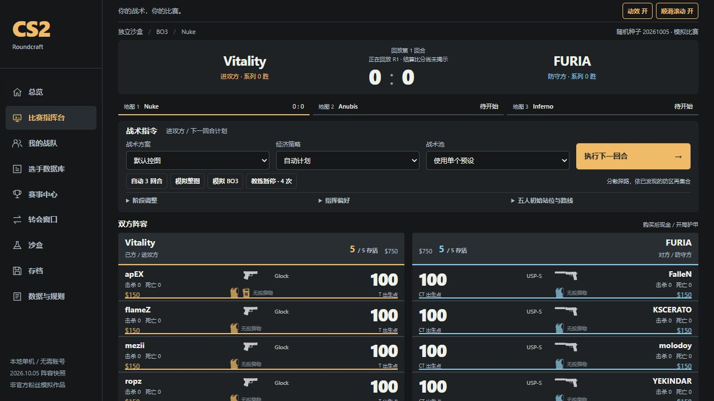

A browser-based tactical manager where your decisions shape a simulated Counter-Strike 2-inspired match. The interface and event-driven commentary are in Simplified Chinese.

[Play online](https://seiya058904.github.io/cs2-roundcraft/) · [Run locally](#run-locally) · [Play guide](docs/PLAY_GUIDE.md)

*Illustration based on the simulation model, not a screenshot.*

## Features

- **Make the calls:** choose tactics, opening positions, purchase policy, and a limited coach timeout before adapting to the next round.
- **Watch the evidence:** follow both five-player rosters, equipment, health, score, and Chinese commentary as events are revealed.
- **Try different formats:** start the featured match, set up a seeded sandbox series, or manage a club through fictional competitions and transfers.
- **Scout players:** browse profiles and compare modeled abilities alongside the available source evidence.
- **Replay and automate:** pause or step through narration, change playback speed, or let the AI make decisions for subsequent rounds.
- **Keep local saves:** use browser autosave and manual slots, with JSON export and import for moving progress between origins.



*Actual browser capture of the local development version; the game interface is in Chinese.*

## Play a round

1. Start the featured Vitality versus FURIA series, configure a sandbox, or begin a club career.
2. Choose a tactical plan and purchase approach. Expand the phase and positioning controls for more detail.
3. Execute the round and follow the scoreboard, roster state, and event-led commentary.
4. Review the outcome, adjust your plan, and continue manually or in an automatic batch.

You command the team; there is no first-person aiming or shooting. An automatic batch supplies later decisions rather than repeating your last manual command.

## Simulation and data

The engine resolves events over connected tactical regions on seven modeled maps. Economy, positioning, utility, timing, and player and team attributes influence the simulation. The observer and commentary read the resulting event sequence; playback does not reroll it. A seed is reproducible only with the same engine, data, roster, and decisions.

The starting rosters are a fixed **October 5, 2026** standings snapshot, not a live transfer feed. Player abilities, team strengths, career results, and the project-specific CTM Rating are game models, not official ratings or match predictions. Evidence coverage varies, and some roles and nationalities remain unverified. The model does not reproduce exact movement, ballistics, grenade trajectories, or official match demos.

## Run locally

**Prerequisites:** Node.js 22.12 or newer and npm.

```sh
npm ci
npm run dev
```

Open the URL printed by Vite. To build and serve the production files locally:

```sh
npm run build
npm run preview -- --port 4173
```

Serve the build over HTTP or HTTPS rather than opening `dist/index.html` directly. The client needs no account, API key, or application backend. After a complete online load, the production site is designed to support offline refresh and Worker-based simulation.

**Back up progress:** autosave and three manual slots use IndexedDB. Export a JSON save before clearing site data, changing browsers, or switching between localhost and the hosted site; browser origins do not share saves automatically.

## Development and testing

The client uses React, TypeScript, Vite, GSAP, and Lenis. Simulation, replay, UI, and persistence are separated across [`src/domain/`](src/domain/), [`src/MatchView.tsx`](src/MatchView.tsx), [`src/simulation.worker.ts`](src/simulation.worker.ts), and [`src/storage.ts`](src/storage.ts).

```sh
npm test -- --maxWorkers=2
npm run data:validate
npm run build
```

Browser tests use the Playwright version in the lockfile:

```sh
npx playwright install chromium
npm run test:e2e
npm run test:offline
npm run test:pages
```

These commands describe the available checks, not a claim that every environment or browser has passed. The [Pages workflow](.github/workflows/pages.yml) contains the deployment checks; historical reports apply to their recorded versions.

## Documentation

- [Play guide](docs/PLAY_GUIDE.md), [engine rules](docs/ENGINE_RULES.md), and [map topology](docs/MAP_TOPOLOGY.md)
- [Player evidence audit](docs/PLAYER_DATA_AUDIT.md), [data sources](docs/DATA_SOURCES.md), and [balance methodology](docs/GAME_BALANCE.md)
- [Deployment](docs/publishing/DEPLOYMENT.md), [changelog](CHANGELOG.md), [contributing](CONTRIBUTING.md), [security](SECURITY.md), and [support](SUPPORT.md)

Broader player evidence, balance calibration, physical-device and browser coverage, and complete real-world rules remain limitations.

## Rights and attribution

No repository-wide open-source license is currently granted. Read the [licensing status](LICENSE.md), [third-party notices](THIRD_PARTY_NOTICES.md), and [equipment source manifest](src/assets/equipment/sources.json) before reuse or redistribution. Some commentary quotation rights have not been independently cleared for unrestricted reuse.

CS2 Roundcraft is an unofficial fan-made project and is not affiliated with or endorsed by Valve, tournament organizers, teams, or players.
