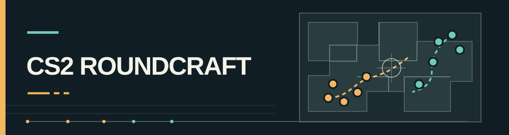

<h1 align="center">🎯 CS2 ROUNDCRAFT</h1>

<p align="center">
  <a href="https://seiya058904.github.io/cs2-roundcraft/">
    
  </a>
  <br>
  <sub>ORIGINAL TACTICAL ILLUSTRATION · ACTUAL GAMEPLAY CAPTURES BELOW</sub>
</p>

<p align="center">
  <strong>Call the round. Read the play. Build the next advantage.</strong>
</p>

<p align="center">
  A Counter-Strike 2-inspired tactical management game that puts you at the command desk.<br>
  Shape the plan, follow an event-driven broadcast, and build a team across a simulated competitive season.
</p>

<p align="center">
  <a href="https://seiya058904.github.io/cs2-roundcraft/"><strong>▶ Play in Your Browser</strong></a>
  &nbsp;·&nbsp;
  <a href="#choose-your-experience">🧭 Experiences</a>
  &nbsp;·&nbsp;
  <a href="#the-round-loop">🎮 How It Plays</a>
  &nbsp;·&nbsp;
  <a href="#inside-the-game">⚡ Game Systems</a>
  &nbsp;·&nbsp;
  <a href="#visuals-and-commentary">🖥️ Screenshots</a>
  &nbsp;·&nbsp;
  <a href="#run-locally">⚙️ Run Locally</a>
</p>

<p align="center">
  <sub>50 SNAPSHOT TEAMS &nbsp;·&nbsp; 250 STARTING PLAYERS &nbsp;·&nbsp; 7 MAPS &nbsp;·&nbsp; 12 MODELED ABILITIES</sub>
</p>

<p align="center">
  <a href="https://github.com/seiya058904/cs2-roundcraft/actions/workflows/pages.yml">
    
  </a>
</p>

<p align="center">
  
  <br>
  <sub>THE MATCH COMMAND DESK · ACTUAL GAMEPLAY CAPTURE</sub>
</p>

---

> **A round is more than a final score.**
>
> Choose where to commit, how to spend, and when to adapt. Then watch the simulation resolve its events: first contact, flashes, trades, rotations, saves and retakes. The commentary follows what happened—not a prewritten winner.

<a id="choose-your-experience"></a>
## 🧭 Choose Your Experience

Different ways to use the same round engine, from a single quick decision to an entire fictional season.

| Experience | Your role | Best for |
| --- | --- | --- |
| **Featured match** | Jump into the prepared Vitality vs FURIA series and make tactical decisions round by round. | Learning the observer, economy and commentary flow. |
| **Sandbox series** | Set lineups, seed and series format; experiment with decisions and compare outcomes. | Trying alternative approaches under repeatable conditions. |
| **Club career** | Manage a roster through simulated competitions, invitations, transfers and progression. | Building a longer story around your team. |
| **Automatic rounds** | Let the AI supply later decisions and inspect what the engine actually recorded. | Watching outcomes without manually calling every round. |

### Decisions in, evidence out

| The manager chooses | The simulation resolves |
| --- | --- |
| Tactical preset, positioning and phase emphasis | Contacts, utility effects, trades and rotations |
| Purchase policy, spending risk and timeout decisions | Round economy, casualties, survival and result |
| Roster and match context | A dated, reproducible event trail and fictional season statistics |

**The game does not ask you to aim or fire a weapon.** The experience is about giving the plan a chance, watching it succeed or fail, and deciding what to change next.

<a id="the-round-loop"></a>
## 🎮 One Round at a Time

<p align="center"><code>SET THE PLAN &nbsp;→&nbsp; EXECUTE THE ROUND &nbsp;→&nbsp; READ THE EVENTS &nbsp;→&nbsp; ADAPT</code></p>

1. **Take command.** Jump straight into a Vitality vs FURIA series, create a seeded sandbox match, or take charge of a club.
2. **Make the call.** Choose a tactical preset, purchase policy and risk level. Expand positioning and phase controls when you want more detail.
3. **Run the round.** Follow Chinese commentary alongside the evolving scoreboard, player health, equipment and event record.
4. **Learn and adjust.** Review the tactical breakdown and event ledger, call a coach timeout when available, and plan the next round.

You control decisions, not individual mouse aim. **Automatic batches let the AI make subsequent decisions**; they are not a recording of repeated manual commands. For reproducibility, keep the same engine, data, seed, roster and decisions.

<a id="inside-the-game"></a>
## ⚡ Inside the Game

<table>
  <tr>
    <td width="50%" valign="top">
      <h3>🧠 Tactical Command</h3>
      <p><sub>PRESETS · PHASES · POSITIONS · ECONOMY</sub></p>
      <p>Choose map-aware plans, assign opening positions, manage purchase strategies, and respond to the evolving round. Coach timeouts offer limited, explicit choices.</p>
    </td>
    <td width="50%" valign="top">
      <h3>📡 Live Match Observer</h3>
      <p><sub>10 PLAYERS · EQUIPMENT · EVENTS · REPLAY</sub></p>
      <p>Follow both five-player teams in a synchronized observer view. Commentary, health, casualties and money are presented at the appropriate event boundary.</p>
    </td>
  </tr>
  <tr>
    <td width="50%" valign="top">
      <h3>🔍 Player Scouting</h3>
      <p><sub>SEARCH · 12 ABILITIES · SIDE-BY-SIDE COMPARISON</sub></p>
      <p>Browse professional identities, check player profiles and compare modeled abilities. Sourced evidence is distinguished from estimates and unverified information.</p>
    </td>
    <td width="50%" valign="top">
      <h3>🏆 Sandbox & Career</h3>
      <p><sub>BO1 / BO3 / BO5 · VETO · SEASONS · TRANSFERS</sub></p>
      <p>Try custom lineups and seeded series, then manage a club through simulated tournaments, invitations, roster exchanges and seasonal progression.</p>
    </td>
  </tr>
</table>

### 🎯 Tactical depth, without manual firefights

The match engine models seven maps as connected tactical regions. Positioning, timing, visible information, utilities, weapon purchases and individual/team attributes influence the events that unfold. Match rules include MR12 halves, side changes and overtime.

The model is **an abstraction of Counter-Strike**, not a recreation of exact movement, ballistics, grenade trajectories or recorded CS2 demos. Its tactical choices have modeled consequences, but it does not claim to predict professional results.

<a id="round-anatomy"></a>
## 🧩 Anatomy of a Simulated Round

<p align="center"><code>PREPARE &nbsp;→&nbsp; OPENING &nbsp;→&nbsp; CONTACT &nbsp;→&nbsp; ROTATE &nbsp;→&nbsp; RESOLVE &nbsp;→&nbsp; REVIEW</code></p>

The broadcast is not a random set of match-themed lines pasted over a scoreboard. The observer and the text commentary read from the same resolved event sequence.

| Moment | What to look for |
| --- | --- |
| **Preparation** | Side, loadout, economy and the intent behind the chosen tactical call. |
| **Opening moves** | Early positions, utility, information and the first engagement. |
| **Mid-round** | Trades, rotations, numbers advantage and changing site pressure. |
| **Resolution** | The modeled plant, retake, elimination, save or timer outcome. |
| **Review** | Event ledger and tactical evidence to inform the next choice. |

Because the event stream is the source of truth, pausing or replaying narration does not reroll the round. A seeded scenario remains reproducible only when its engine version, data and decisions match.

<a id="visuals-and-commentary"></a>
## 🖥️ A Match You Can Actually Read

The observer interface is arranged around the decisions and their consequences: commands above the action, attacking and defending sides identified by color, and commentary supported by a replayable event trail. Your selected team stays on the left even after a side switch.

<table>
  <tr>
    <td width="50%" valign="top">
      
      <p align="center"><sub>PLAYER PROFILES · TWELVE MODELED ABILITIES</sub></p>
    </td>
    <td width="50%" valign="top">
      
      <p align="center"><sub>SCOUTING · PLAYER COMPARISONS</sub></p>
    </td>
  </tr>
</table>

<details>
<summary><strong>📱 View the narrow-screen match layout</strong></summary>

<p align="center">
  
</p>

The layout was exercised in automated Chromium checks at 390, 1024, 1280 and 1440 pixels. This is not a claim of full physical-phone, Safari or Firefox certification.

</details>

### 🎙️ Commentary driven by the event ledger

The Chinese-language broadcast is assembled from simulated match events, authored connective lines and attributed quotation material. **Detailed** and **brief** reading modes share the same underlying events. You can pause, step through a round or change playback speed without changing its result.

- The observer waits to reveal later kills, health changes and results until the corresponding event boundary.
- Source-backed quotations are constrained by their context; the game does not generate a false kill merely to fit a line.
- Commentary nicknames can appear with formal player names in parentheses. Roster and statistics views retain the formal names.

This is local text narration, **not recorded audio commentary or a live language-model service**.

<a id="the-data"></a>
## 📊 The Data Behind the Simulation

| Layer | What it represents |
| --- | --- |
| **Teams & rosters** | A fixed snapshot derived from Valve's **October 5, 2026** regional standings: 50 teams and 250 starting seats, not a live transfer feed |
| **Player evidence** | Dated identity, roles and selected performance sources; coverage differs substantially between players |
| **Twelve abilities** | Interpretable **game estimates**, not official ratings, verified individual measurements or match predictions |
| **Team & map strengths** | Simulated chemistry, preparation, tactical familiarity and region-level movement assumptions |
| **Season & statistics** | Fictional career outcomes and a project-specific CTM Rating, **not** official tournament results or HLTV Rating |
| **Narration** | Event-based Chinese commentary with original text and attributed quotation material |

At the documented snapshot, **40 roles remain unverified** and **41 nationalities lack confirmed evidence**. The numerical evidence is especially concentrated among a smaller group of players. Missing source material is not silently promoted to fact.

Read the [player evidence audit](docs/PLAYER_DATA_AUDIT.md), [data-source notes](docs/DATA_SOURCES.md) and [balance methodology](docs/GAME_BALANCE.md) for sources, limitations and formulas.

<a id="run-locally"></a>
## 🚀 Play or Run Locally

### 🌐 Play online

**[Open CS2 Roundcraft →](https://seiya058904.github.io/cs2-roundcraft/)**

The game is client-side and does not need a login, API key or application backend. The **game interface and commentary are in Simplified Chinese**; the project README is written in English.

### 💻 Run from source

Requires **Node.js 22.12+** and npm. Clone the repository and run:

```bash
npm ci
npm run dev
```

Open the local URL printed by Vite, normally **http://127.0.0.1:5173/**.

For a production build and local preview:

```bash
npm run build
npm run preview -- --port 4173
```

After the production site's first complete online load and caching, the app can support offline refresh and Worker-based simulation. Serve the built files over HTTP or HTTPS; do not open `dist/index.html` directly from disk.

> [!IMPORTANT]
> **Back up your progress.** Autosave and three manual slots use browser IndexedDB. Export a JSON save before clearing site data, changing browsers or switching between localhost and the hosted site. Different origins do not share saves automatically.

<a id="for-developers"></a>
## 🛠️ For Developers

**React 19 · TypeScript · Vite · Vitest · Playwright · GSAP · Lenis**

The deterministic simulation, user interface, event narration and local persistence are separated so presentation changes need not rewrite past match outcomes.

<details>
<summary><strong>⚙️ Expand verification commands and repository map</strong></summary>

### Verification

```bash
npm test -- --maxWorkers=2
npm run data:validate
npm run build

npx playwright install chromium
npm run test:e2e
npm run test:offline
npm run test:pages
```

The [GitHub Pages workflow](.github/workflows/pages.yml) runs verification before deployment. Browser checks cover gameplay and a production subpath; the badge at the top links to the **current** workflow state rather than promising that every future commit passes.

Further simulation experiments are available with `npm run sim:stress`, `npm run sim:career`, `npm run sim:commentary`, `npm run sim:tactics` and `npm run sim:matrix`. Reports in `docs/` are historical evidence from their recorded versions, not automatic proof of the current checkout's balance.

### Repository map

| Path | Purpose |
| --- | --- |
| [`src/domain/`](src/domain/) | Match rules, tactics, economy, careers, replay and save validation |
| [`src/MatchCommand.tsx`](src/MatchCommand.tsx) | Tactical commands and round execution |
| [`src/MatchView.tsx`](src/MatchView.tsx) | Observer, narration and replay |
| [`src/MatchRoster.tsx`](src/MatchRoster.tsx) | Mirrored player/equipment display |
| [`src/simulation.worker.ts`](src/simulation.worker.ts) | Background simulation and safe cancellation |
| [`src/storage.ts`](src/storage.ts) | IndexedDB saves and recovery |
| [`src/data/`](src/data/) · [`data/source/`](data/source/) | Runtime datasets and their provenance |
| [`tests/`](tests/) · [`scripts/`](scripts/) | Regressions, importers and simulation experiments |

`npm run data:import` regenerates derived data from checked-in sources; it is **not** part of normal gameplay startup.

</details>

## 📚 Documentation & Known Limits

- **[Play guide](docs/PLAY_GUIDE.md)** — a practical walkthrough of the Chinese game interface.
- **[Engine rules](docs/ENGINE_RULES.md)** — the simulation's rule boundaries.
- **[Map topology](docs/MAP_TOPOLOGY.md)** — modeled regions, routes and sight lines.
- **[Data provenance](docs/DATA_SOURCES.md)** — rosters, identities, statistics and estimated abilities.
- **[Latest upgrade report](docs/UPGRADE_REPORT.md)** — implemented scope, sampled verification and remaining work.
- **[Deployment notes](docs/publishing/DEPLOYMENT.md)** — GitHub Pages, relative asset paths and offline cache behavior.
- **[Changelog](CHANGELOG.md)** · **[Contributing](CONTRIBUTING.md)** · **[Security](SECURITY.md)** · **[Support](SUPPORT.md)**.

Areas still needing attention include broader player evidence, balance calibration, full real-world match physics and tournament rules, and testing on more browsers and physical devices. A passed automated test does not resolve those limitations.

## ❓ Frequently Asked Questions

<details>
<summary><strong>Is this a playable first-person Counter-Strike game?</strong></summary>

No. CS2 Roundcraft is a **browser-based tactical and team-management simulation**. You make decisions; the simulation resolves encounters and presents them as text, statistics and observer events.

</details>

<details>
<summary><strong>Are the teams, ratings and match results official?</strong></summary>

No. The starting identities and roster snapshot reference dated source material, but ability scores, team strengths, season outcomes and the CTM Rating are **game models**. They should not be read as official player rankings or real-world predictions.

</details>

<details>
<summary><strong>Can I play offline or move my save to another computer?</strong></summary>

An already loaded and cached production site can support offline refresh. For portability, **export your save as JSON** and import it on the other device or browser; local IndexedDB data does not synchronize between origins.

</details>

<details>
<summary><strong>Why is the commentary in Chinese when this README is in English?</strong></summary>

The game's current interface and narration are in Simplified Chinese. The English README documents how it works; it does not imply an English-language in-game mode.

</details>

## 📜 Sources, Attribution & Rights

This is an **unofficial, fan-made CS2-inspired simulation**, not a Counter-Strike client, match-demo parser or product endorsed by Valve, tournament organizers, teams or players.

The project contains material with different upstream terms, including equipment artwork, identity data and commentary quotations. See [Third-party notices](THIRD_PARTY_NOTICES.md) and the [equipment source manifest](src/assets/equipment/sources.json) for provenance. Some quotation rights have **not** been independently cleared for unrestricted reuse.

**No repository-wide open-source license is currently granted.** Read the [licensing status](LICENSE.md) before reusing, redistributing or publishing parts of the code or assets.

---

<p align="center">
  <sub>FIVE PLAYERS. ONE PLAN. ONE MORE ROUND TO GET IT RIGHT.</sub><br>
  <sub>CS2 Roundcraft · The decisions are yours. The simulation tells the story.</sub>
</p>
