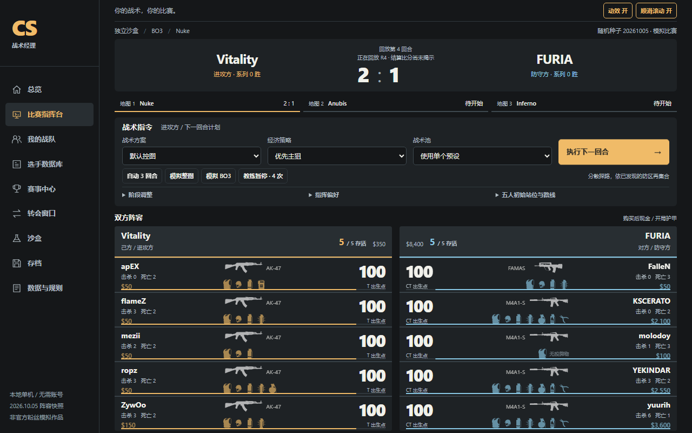
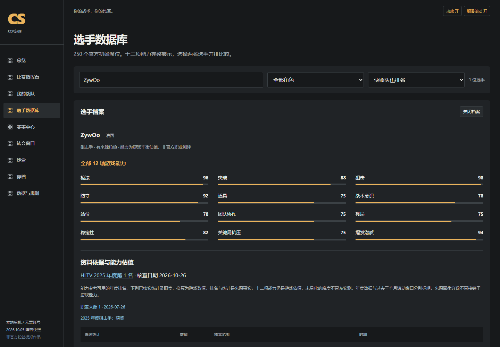
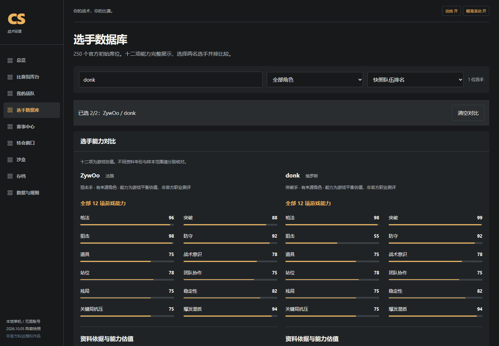
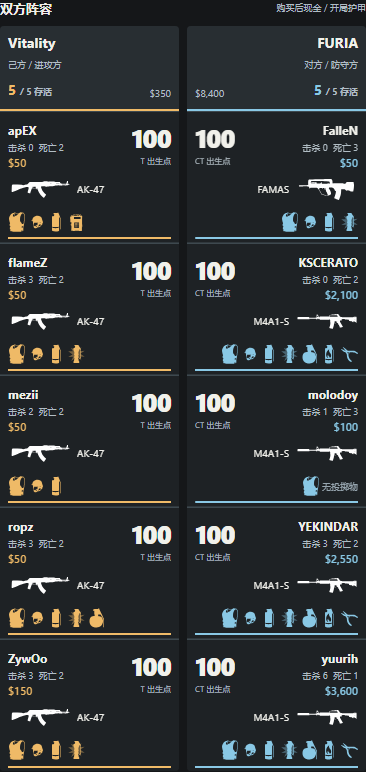

<h1 align="center">🎯 CS2 ROUNDCRAFT</h1>

<p align="center">
  <strong>Call the round. Read the play. Build the next advantage.</strong>
</p>

<p align="center">
  A Counter-Strike 2-inspired tactical management game that puts you at the command desk.<br>
  Shape the plan, follow an event-driven broadcast, and build a team across a simulated competitive season.
</p>

<p align="center">
  <a href="https://seiya058904.github.io/cs2-roundcraft/"><strong>▶ Play in Your Browser</strong></a>
  &nbsp;·&nbsp;
  <a href="#the-round-loop">🎮 How It Plays</a>
  &nbsp;·&nbsp;
  <a href="#inside-the-game">⚡ Game Systems</a>
  &nbsp;·&nbsp;
  <a href="#visuals-and-commentary">🖥️ Screenshots</a>
  &nbsp;·&nbsp;
  <a href="#run-locally">⚙️ Run Locally</a>
</p>

<p align="center">
  <sub>50 SNAPSHOT TEAMS &nbsp;·&nbsp; 250 STARTING PLAYERS &nbsp;·&nbsp; 7 MAPS &nbsp;·&nbsp; 12 MODELED ABILITIES</sub>
</p>

<p align="center">
  <a href="https://github.com/seiya058904/cs2-roundcraft/actions/workflows/pages.yml">
    
  </a>
</p>

<p align="center">
  
  <br>
  <sub>THE MATCH COMMAND DESK · ACTUAL GAMEPLAY CAPTURE</sub>
</p>

---

> **A round is more than a final score.**
>
> Choose where to commit, how to spend, and when to adapt. Then watch the simulation resolve its events: first contact, flashes, trades, rotations, saves and retakes. The commentary follows what happened—not a prewritten winner.

<a id="the-round-loop"></a>
## 🎮 One Round at a Time

<p align="center"><code>SET THE PLAN &nbsp;→&nbsp; EXECUTE THE ROUND &nbsp;→&nbsp; READ THE EVENTS &nbsp;→&nbsp; ADAPT</code></p>

1. **Take command.** Jump straight into a Vitality vs FURIA series, create a seeded sandbox match, or take charge of a club.
2. **Make the call.** Choose a tactical preset, purchase policy and risk level. Expand positioning and phase controls when you want more detail.
3. **Run the round.** Follow Chinese commentary alongside the evolving scoreboard, player health, equipment and event record.
4. **Learn and adjust.** Review the tactical breakdown and event ledger, call a coach timeout when available, and plan the next round.

You control decisions, not individual mouse aim. **Automatic batches let the AI make subsequent decisions**; they are not a recording of repeated manual commands. For reproducibility, keep the same engine, data, seed, roster and decisions.

<a id="inside-the-game"></a>
## ⚡ Inside the Game

<table>
  <tr>
    <td width="50%" valign="top">
      <h3>🧠 Tactical Command</h3>
      <p><sub>PRESETS · PHASES · POSITIONS · ECONOMY</sub></p>
      <p>Choose map-aware plans, assign opening positions, manage purchase strategies, and respond to the evolving round. Coach timeouts offer limited, explicit choices.</p>
    </td>
    <td width="50%" valign="top">
      <h3>📡 Live Match Observer</h3>
      <p><sub>10 PLAYERS · EQUIPMENT · EVENTS · REPLAY</sub></p>
      <p>Follow both five-player teams in a synchronized observer view. Commentary, health, casualties and money are presented at the appropriate event boundary.</p>
    </td>
  </tr>
  <tr>
    <td width="50%" valign="top">
      <h3>🔍 Player Scouting</h3>
      <p><sub>SEARCH · 12 ABILITIES · SIDE-BY-SIDE COMPARISON</sub></p>
      <p>Browse professional identities, check player profiles and compare modeled abilities. Sourced evidence is distinguished from estimates and unverified information.</p>
    </td>
    <td width="50%" valign="top">
      <h3>🏆 Sandbox & Career</h3>
      <p><sub>BO1 / BO3 / BO5 · VETO · SEASONS · TRANSFERS</sub></p>
      <p>Try custom lineups and seeded series, then manage a club through simulated tournaments, invitations, roster exchanges and seasonal progression.</p>
    </td>
  </tr>
</table>

### 🎯 Tactical depth, without manual firefights

The match engine models seven maps as connected tactical regions. Positioning, timing, visible information, utilities, weapon purchases and individual/team attributes influence the events that unfold. Match rules include MR12 halves, side changes and overtime.

The model is **an abstraction of Counter-Strike**, not a recreation of exact movement, ballistics, grenade trajectories or recorded CS2 demos. Its tactical choices have modeled consequences, but it does not claim to predict professional results.

<a id="visuals-and-commentary"></a>
## 🖥️ A Match You Can Actually Read

The observer interface is arranged around the decisions and their consequences: commands above the action, attacking and defending sides identified by color, and commentary supported by a replayable event trail. Your selected team stays on the left even after a side switch.

<table>
  <tr>
    <td width="50%" valign="top">
      
      <p align="center"><sub>PLAYER PROFILES · TWELVE MODELED ABILITIES</sub></p>
    </td>
    <td width="50%" valign="top">
      
      <p align="center"><sub>SCOUTING · PLAYER COMPARISONS</sub></p>
    </td>
  </tr>
</table>

<details>
<summary><strong>📱 View the narrow-screen match layout</strong></summary>

<p align="center">
  
</p>

The layout was exercised in automated Chromium checks at 390, 1024, 1280 and 1440 pixels. This is not a claim of full physical-phone, Safari or Firefox certification.

</details>

### 🎙️ Commentary driven by the event ledger

The Chinese-language broadcast is assembled from simulated match events, authored connective lines and attributed quotation material. **Detailed** and **brief** reading modes share the same underlying events. You can pause, step through a round or change playback speed without changing its result.

- The observer waits to reveal later kills, health changes and results until the corresponding event boundary.
- Source-backed quotations are constrained by their context; the game does not generate a false kill merely to fit a line.
- Commentary nicknames can appear with formal player names in parentheses. Roster and statistics views retain the formal names.

This is local text narration, **not recorded audio commentary or a live language-model service**.

<a id="the-data"></a>
## 📊 The Data Behind the Simulation

| Layer | What it represents |
| --- | --- |
| **Teams & rosters** | A fixed snapshot derived from Valve's **October 5, 2026** regional standings: 50 teams and 250 starting seats, not a live transfer feed |
| **Player evidence** | Dated identity, roles and selected performance sources; coverage differs substantially between players |
| **Twelve abilities** | Interpretable **game estimates**, not official ratings, verified individual measurements or match predictions |
| **Team & map strengths** | Simulated chemistry, preparation, tactical familiarity and region-level movement assumptions |
| **Season & statistics** | Fictional career outcomes and a project-specific CTM Rating, **not** official tournament results or HLTV Rating |
| **Narration** | Event-based Chinese commentary with original text and attributed quotation material |

At the documented snapshot, **40 roles remain unverified** and **41 nationalities lack confirmed evidence**. The numerical evidence is especially concentrated among a smaller group of players. Missing source material is not silently promoted to fact.

Read the [player evidence audit](docs/PLAYER_DATA_AUDIT.md), [data-source notes](docs/DATA_SOURCES.md) and [balance methodology](docs/GAME_BALANCE.md) for sources, limitations and formulas.

<a id="run-locally"></a>
## 🚀 Play or Run Locally

### 🌐 Play online

**[Open CS2 Roundcraft →](https://seiya058904.github.io/cs2-roundcraft/)**

The game is client-side and does not need a login, API key or application backend. The **game interface and commentary are in Simplified Chinese**; the project README is written in English.

### 💻 Run from source

Requires **Node.js 22.12+** and npm. Clone the repository and run:

```bash
npm ci
npm run dev
```

Open the local URL printed by Vite, normally **http://127.0.0.1:5173
